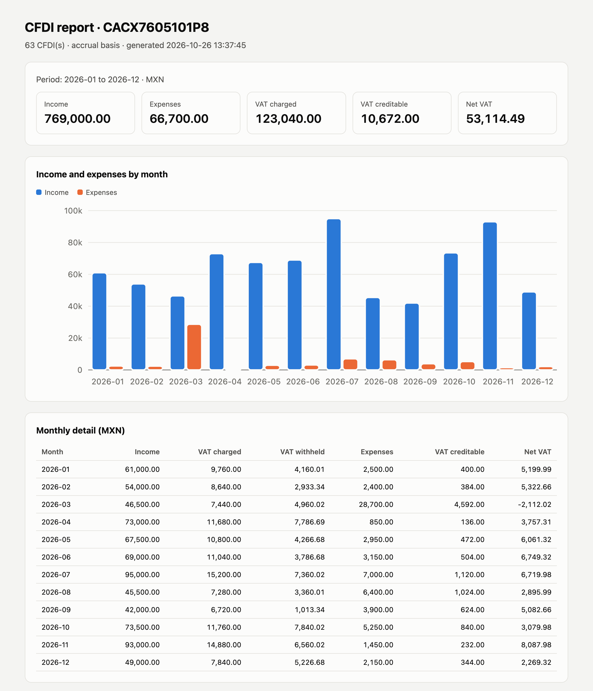

# cfdi-kit

Convierte una carpeta de facturas CFDI del SAT (XML) en Excel, DataFrames de pandas, un resumen mensual de ingresos, gastos e IVA y un reporte HTML de un solo archivo. Todo corre en tu computadora; ningún dato de tus facturas sale de ella.

[](https://github.com/DiegoTepichin/cfdi-kit/actions/workflows/ci.yml)
[](LICENSE)

[Read in English](README.md)



*`cfdi-kit report` sobre las facturas sintéticas de [`examples/demo`](examples/demo).*

## Por qué

Cada factura en México es un XML. Revisar un mes implica abrir archivos uno por uno, capturar montos a mano en Excel o subir tu información fiscal a un servicio en la nube. `cfdi-kit` lee cientos de CFDIs en un segundo, directo de la carpeta o del ZIP que descargas del portal del SAT, sin que salgan de tu equipo.

## Instalación

```bash
pip install cfdi-kit
```

o sin instalar, con [uv](https://docs.astral.sh/uv/):

```bash
uvx cfdi-kit --help
```

Requiere Python 3.11 o superior.

## Inicio rápido

Pruébalo con las facturas de ejemplo (una persona freelance ficticia, RFC `CACX7605101P8`, un año de facturas):

```bash
git clone https://github.com/DiegoTepichin/cfdi-kit && cd cfdi-kit
uv run cfdi-kit summary examples/demo --rfc CACX7605101P8 --basis cash
```

```text
CACX7605101P8 · cash basis · MXN

  Month     Income  VAT charged  VAT withheld   Expenses  VAT creditable   Net VAT
-------  ---------  -----------  ------------  ---------  --------------  --------
2026-01  61,000.00     9,760.00      4,160.01   2,500.00          400.00  5,199.99
2026-02  26,500.00     4,240.00          0.00   2,400.00          384.00  3,856.00
2026-03  74,000.00    11,840.00      7,893.36  28,700.00        4,592.00   -645.36
...
```

Con tus propias facturas:

```bash
cfdi-kit parse ~/Downloads/facturas -o facturas.xlsx --rfc TU_RFC    # Excel con 3 hojas
cfdi-kit summary ~/Downloads/facturas --rfc TU_RFC                   # tabla mensual
cfdi-kit report ~/Downloads/facturas --rfc TU_RFC -o reporte.html    # reporte HTML
cfdi-kit validate ~/Downloads/facturas                               # validaciones
```

Todos los comandos aceptan cualquier combinación de archivos `.xml`, carpetas (se buscan de forma recursiva) y archivos `.zip`. Los archivos ilegibles se listan y se omiten; los UUID repetidos se cuentan una sola vez.

## Qué lee

| | Soportado |
|---|---|
| CFDI | 4.0 y 3.3 (tipos I, E, T, N y P) |
| Complementos | Timbre Fiscal Digital 1.1, Pagos 2.0 y 1.0, Nómina 1.2 |
| Dinero | `Decimal` de principio a fin; moneda extranjera convertida con el tipo de cambio de la factura o del pago |

CFDI 3.2 y anteriores se reportan como no soportados.

## Comandos

### `parse`: Excel o CSV

`cfdi-kit parse RUTAS -o salida.xlsx [--rfc RFC]` escribe tres hojas: `invoices` (una fila por CFDI, con impuestos, totales en MXN y descripciones de los catálogos del SAT), `line_items` (conceptos) y `payments` (cada factura liquidada en un complemento de pago). Con `-o salida.csv` escribe solo la tabla de facturas. `--rfc` agrega la columna `direction` (`issued` emitida / `received` recibida).

### `summary`: ingresos, gastos e IVA por mes

`cfdi-kit summary RUTAS --rfc RFC [--basis accrual|cash] [-o archivo]`

- **accrual** (por defecto): cada factura cuenta en su fecha de emisión.
- **cash** (flujo de efectivo): las facturas `PUE` cuentan en su fecha de emisión; las `PPD`, cuando un complemento de pago las liquida, en la fecha del pago. El desglose de impuestos de Pagos 2.0 se usa tal cual; los pagos de Pagos 1.0 se prorratean contra la factura original si está en la carpeta.

Las notas de crédito (`E`) restan. La nómina (`N`) se reporta en columnas aparte. *Net VAT* es el IVA trasladado, menos el IVA que te retuvieron tus clientes, menos el IVA acreditable.

### `report`: un archivo HTML

`cfdi-kit report RUTAS --rfc RFC [--basis] [-o reporte.html]` escribe un solo archivo sin scripts ni recursos externos: totales, gráfica de ingresos contra gastos, tabla mensual, principales clientes y proveedores, facturas PPD con saldo pendiente y todas las observaciones de la validación. Respeta el tema claro u oscuro del sistema.

### `validate`: encuentra errores antes de que lleguen a tu contabilidad

```text
$ cfdi-kit validate broken.xml
error    total-mismatch                broken.xml  Total is 99999.99 but SubTotal - Descuento + taxes is 34796.65
1 error(s), 0 warning(s)
```

Revisa: timbre faltante; total, subtotal o descuento que no cuadran (se permite un centavo de redondeo por concepto); impuestos de la factura contra los de los conceptos; RFC mal formados; facturas PPD con forma de pago distinta de 99; moneda extranjera sin tipo de cambio y UUID duplicados. Termina con código 1 si encuentra errores, para usarlo en scripts.

### `risk`: revisa a tus proveedores contra la lista 69-B del SAT

El SAT publica a los contribuyentes que presume emiten facturas por operaciones inexistentes (artículo 69-B del Código Fiscal de la Federación). Descarga el archivo una vez y revisa a tus proveedores sin conexión:

```bash
curl -o Listado_completo_69-B.csv http://omawww.sat.gob.mx/cifras_sat/Documents/Listado_completo_69-B.csv
cfdi-kit risk RUTAS --list Listado_completo_69-B.csv [--rfc RFC]
```

```text
$ cfdi-kit risk examples/demo --list examples/demo-69b.csv --rfc CACX7605101P8
Definitivo           KIJ0906199R1   2026-01-04  AF67D461-E416-3207-D094-499602F0EE99      1,044.00 MXN  KERNEL INDUSTIA JUGUETERA
Presunto             MAG041126GT8   2026-02-17  D1711CBD-2106-119E-C40D-31B5397A7623        522.00 MXN  MINERA AGUILAR
...
29 match(es) against the 69-B list dated 2025-12-31, 18 presumed or definitive
```

`examples/demo-69b.csv` es una lista sintética para las facturas de demostración, no la del SAT. Con el archivo real (14,234 filas, con fecha del 31 de diciembre de 2025), las mismas 63 facturas de la demo se revisan en unos 0.3 segundos.

- El comando lee un archivo local y tus facturas; nunca se conecta a internet. Descarga tú la lista y anota su fecha: se imprime con cada resultado.
- Cada factura cuyo **emisor** está en la lista se muestra con el estatus del SAT: `Definitivo`, `Presunto`, `Desvirtuado` o `Sentencia Favorable`. Con `--rfc`, solo se revisan las facturas que recibiste.
- El archivo del SAT puede listar un RFC en varias filas (trámites distintos, por ejemplo `Definitivo` y `Sentencia Favorable`). Las filas no están en orden cronológico, así que el resultado muestra la más grave y una fila posterior nunca absuelve a una anterior.
- El comando termina con estado 1 si alguna coincidencia es `Presunto` o `Definitivo`.
- `report --risk-list ARCHIVO` agrega la misma tabla al reporte HTML.

Una coincidencia es una coincidencia con una lista pública, no una acusación. La lista cambia, los contribuyentes pueden desvirtuar y la herramienta no sustituye a un contador.

## API de Python

```python
from pathlib import Path

import cfdi_kit

result = cfdi_kit.load(["examples/demo"])  # archivos, carpetas o ZIPs
print(len(result.cfdis), "invoices,", len(result.errors), "errors")

cfdi = result.cfdis[0]
cfdi.uuid, cfdi.issuer.rfc, cfdi.total, cfdi.iva_transferred  # tipado, Decimal

invoices = cfdi_kit.invoices_frame(result.cfdis, rfc="CACX7605101P8")  # pandas
invoices.groupby("direction")["total_mxn"].sum()

summary = cfdi_kit.summarize(result.cfdis, "CACX7605101P8", cfdi_kit.Basis.CASH)
cfdi_kit.summary_frame(summary)

issues = cfdi_kit.validate(result.cfdis)

snapshot = cfdi_kit.load_snapshot(Path("Listado_completo_69-B.csv"))  # tu propia descarga
matches = cfdi_kit.find_matches(result.cfdis, snapshot, rfc="CACX7605101P8")
```

También: `parse_file`, `parse_bytes`, `concepts_frame`, `payments_frame`, `to_csv` y `to_excel`. El paquete incluye anotaciones de tipos (`py.typed`).

## Límites

- Solo lee el XML. No verifica los sellos digitales ni consulta al SAT si una factura fue cancelada; quita las canceladas antes de resumir.
- El resumen es una ayuda para revisar un periodo. No es una declaración y no sustituye a tu contador.
- No emite, timbra, cancela ni descarga facturas, ni descarga por ti la lista 69-B.

## Desarrollo

```bash
uv sync
uv run pytest
uv run ruff check . && uv run ruff format --check . && uv run mypy .
uv run python examples/generate_demo.py examples/demo   # regenera las facturas de ejemplo
```

Los fixtures de prueba y las facturas de ejemplo son sintéticos y usan los RFC de prueba públicos del SAT. Ver [CONTRIBUTING.md](CONTRIBUTING.md). Un CFDI que no se puede leer es el reporte de bug más útil: anonimízalo y abre un issue.

## Licencia

[MIT](LICENSE) © Diego Tepichin
