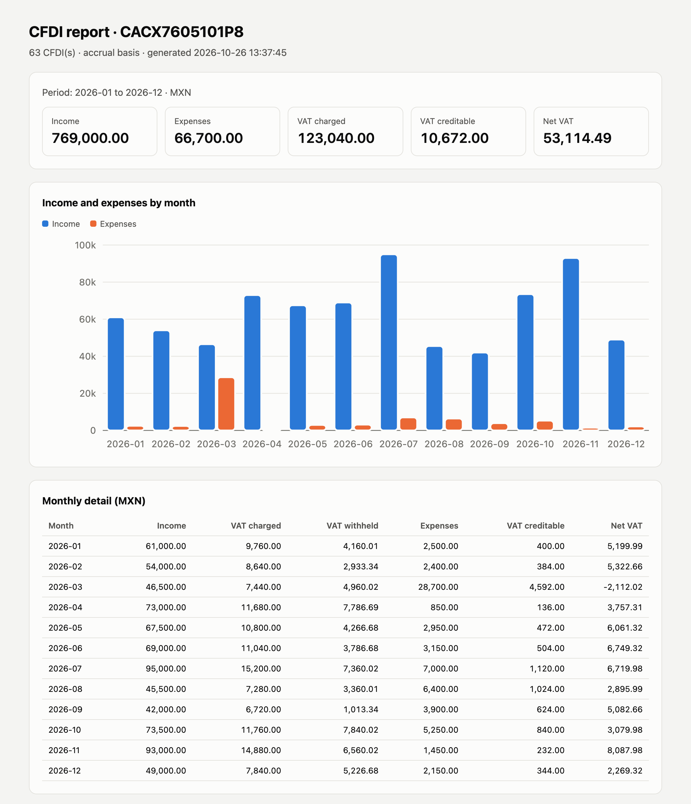

# cfdi-kit

Turn a folder of SAT CFDI invoices (XML) into Excel, pandas DataFrames, a monthly income / expense / VAT summary and a one-file HTML report. Everything runs on your machine; no invoice data is sent anywhere.

[](https://github.com/DiegoTepichin/cfdi-kit/actions/workflows/ci.yml)
[](LICENSE)

[Leer en español](README.es.md)



*`cfdi-kit report` on the synthetic invoices in [`examples/demo`](examples/demo).*

## Why

Every Mexican invoice is an XML file. Reading a month of them means opening files one by one, retyping amounts into a spreadsheet or uploading your tax data to a cloud service. `cfdi-kit` reads hundreds of CFDIs in a second, straight from the folder or the ZIP the SAT portal gives you, and keeps them on your computer.

## Install

```bash
pip install cfdi-kit
```

or run it without installing, with [uv](https://docs.astral.sh/uv/):

```bash
uvx cfdi-kit --help
```

Requires Python 3.11+.

## Quickstart

Try it on the bundled demo (a fictional freelancer, RFC `CACX7605101P8`, one year of invoices):

```bash
git clone https://github.com/DiegoTepichin/cfdi-kit && cd cfdi-kit
uv run cfdi-kit summary examples/demo --rfc CACX7605101P8 --basis cash
```

```text
CACX7605101P8 · cash basis · MXN

  Month     Income  VAT charged  VAT withheld   Expenses  VAT creditable   Net VAT
-------  ---------  -----------  ------------  ---------  --------------  --------
2026-01  61,000.00     9,760.00      4,160.01   2,500.00          400.00  5,199.99
2026-02  26,500.00     4,240.00          0.00   2,400.00          384.00  3,856.00
2026-03  74,000.00    11,840.00      7,893.36  28,700.00        4,592.00   -645.36
...
```

With your own invoices:

```bash
cfdi-kit parse ~/Downloads/facturas -o facturas.xlsx --rfc YOUR_RFC   # Excel with 3 sheets
cfdi-kit summary ~/Downloads/facturas --rfc YOUR_RFC                  # monthly table
cfdi-kit report ~/Downloads/facturas --rfc YOUR_RFC -o reporte.html   # HTML report
cfdi-kit validate ~/Downloads/facturas                                # consistency checks
```

Every command accepts any mix of `.xml` files, folders (searched recursively) and `.zip` archives. Unreadable files are listed and skipped; repeated UUIDs are counted once.

## What it reads

| | Supported |
|---|---|
| CFDI | 4.0 and 3.3 (types I, E, T, N and P) |
| Complements | Timbre Fiscal Digital 1.1, Pagos 2.0 and 1.0, Nómina 1.2 |
| Money | `Decimal` end to end; foreign currency converted with the invoice or payment exchange rate |

CFDI 3.2 and earlier are reported as unsupported.

## Commands

### `parse`: Excel or CSV

`cfdi-kit parse PATHS -o out.xlsx [--rfc RFC]` writes three sheets: `invoices` (one row per CFDI, with taxes, totals in MXN and SAT catalog labels), `line_items` and `payments` (each invoice settled by a payment complement). With `-o out.csv` it writes the invoices table only. `--rfc` adds a `direction` column (`issued` / `received`).

### `summary`: income, expenses and VAT per month

`cfdi-kit summary PATHS --rfc RFC [--basis accrual|cash] [-o file]`

- **accrual** (default): every invoice counts on its issue date.
- **cash**: `PUE` invoices count on their issue date; `PPD` invoices count when a payment complement settles them, on the payment date. Pagos 2.0 tax breakdowns are used as written; Pagos 1.0 payments are prorated against the original invoice when it is in the folder.

Credit notes (`E`) subtract. Payroll (`N`) is reported in separate columns. *Net VAT* is VAT charged, minus VAT withheld by your clients, minus creditable VAT.

### `report`: one HTML file

`cfdi-kit report PATHS --rfc RFC [--basis] [-o report.html]` writes a single file with no scripts or external assets: totals, an income vs expense chart, the monthly table, top clients and suppliers, PPD invoices with an open balance and every validation issue. It follows the system's light or dark theme.

### `validate`: catch errors before they reach your books

```text
$ cfdi-kit validate broken.xml
error    total-mismatch                broken.xml  Total is 99999.99 but SubTotal - Descuento + taxes is 34796.65
1 error(s), 0 warning(s)
```

Checks: missing stamp, total / subtotal / discount that don't add up (one cent of rounding per line allowed), invoice vs line-item tax totals, malformed RFCs, PPD invoices with a payment form other than 99, foreign currency without an exchange rate and duplicate UUIDs. The command exits with status 1 when it finds errors, so you can use it in scripts.

### `risk`: check suppliers against the SAT 69-B list

The SAT publishes the taxpayers it presumes issue invoices for non-existent operations (article 69-B of the Código Fiscal de la Federación). Download the file once and check your suppliers against it, offline:

```bash
curl -o Listado_completo_69-B.csv http://omawww.sat.gob.mx/cifras_sat/Documents/Listado_completo_69-B.csv
cfdi-kit risk PATHS --list Listado_completo_69-B.csv [--rfc RFC]
```

```text
$ cfdi-kit risk examples/demo --list examples/demo-69b.csv --rfc CACX7605101P8
Definitivo           KIJ0906199R1   2026-01-04  AF67D461-E416-3207-D094-499602F0EE99      1,044.00 MXN  KERNEL INDUSTIA JUGUETERA
Presunto             MAG041126GT8   2026-02-17  D1711CBD-2106-119E-C40D-31B5397A7623        522.00 MXN  MINERA AGUILAR
...
29 match(es) against the 69-B list dated 2025-12-31, 18 presumed or definitive
```

`examples/demo-69b.csv` is a synthetic list for the demo invoices, not the SAT's. With the real file (14,234 rows, dated 31 December 2025), the same 63 demo invoices are checked in about 0.3 seconds.

- The command reads one local file and your invoices; it never goes online. Download the list yourself and note its date: it is printed with every result.
- Each invoice whose **issuer** is on the list is shown with the SAT's status: `Definitivo`, `Presunto`, `Desvirtuado` or `Sentencia Favorable`. With `--rfc`, only invoices you received are checked.
- The SAT file can list one RFC in several rows (separate proceedings, for example `Definitivo` and `Sentencia Favorable`). The rows are not in chronological order, so a result shows the most serious one and a later row never clears an earlier one.
- The command exits with status 1 if any match is `Presunto` or `Definitivo`.
- `report --risk-list FILE` adds the same table to the HTML report.

A match is a coincidence with a public list, not an accusation. The list changes, taxpayers can be cleared, and the tool does not replace an accountant.

## Python API

```python
from pathlib import Path

import cfdi_kit

result = cfdi_kit.load(["examples/demo"])  # files, folders or ZIPs
print(len(result.cfdis), "invoices,", len(result.errors), "errors")

cfdi = result.cfdis[0]
cfdi.uuid, cfdi.issuer.rfc, cfdi.total, cfdi.iva_transferred  # typed, Decimal

invoices = cfdi_kit.invoices_frame(result.cfdis, rfc="CACX7605101P8")  # pandas
invoices.groupby("direction")["total_mxn"].sum()

summary = cfdi_kit.summarize(result.cfdis, "CACX7605101P8", cfdi_kit.Basis.CASH)
cfdi_kit.summary_frame(summary)

issues = cfdi_kit.validate(result.cfdis)

snapshot = cfdi_kit.load_snapshot(Path("Listado_completo_69-B.csv"))  # your own download
matches = cfdi_kit.find_matches(result.cfdis, snapshot, rfc="CACX7605101P8")
```

Also available: `parse_file`, `parse_bytes`, `concepts_frame`, `payments_frame`, `to_csv` and `to_excel`. The package ships type hints (`py.typed`).

## Limits

- It reads the XML only. It does not verify the digital seals or ask the SAT whether an invoice was cancelled; remove cancelled invoices before summarizing.
- The summary is an aid to review a period. It is not a tax return and does not replace an accountant.
- It does not issue, stamp, cancel or download invoices, and it does not download the 69-B list for you.

## Development

```bash
uv sync
uv run pytest
uv run ruff check . && uv run ruff format --check . && uv run mypy .
uv run python examples/generate_demo.py examples/demo   # regenerate the demo invoices
```

The test fixtures and demo invoices are synthetic and use the SAT's public test RFCs. See [CONTRIBUTING.md](CONTRIBUTING.md). A CFDI that fails to parse is the most useful bug report you can send: anonymize it and open an issue.

## License

[MIT](LICENSE) © Diego Tepichin
